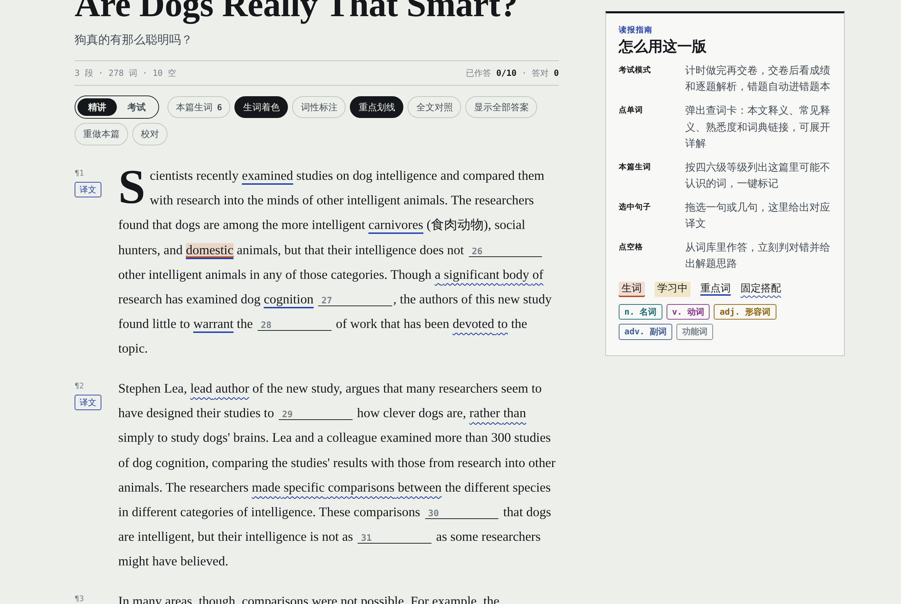
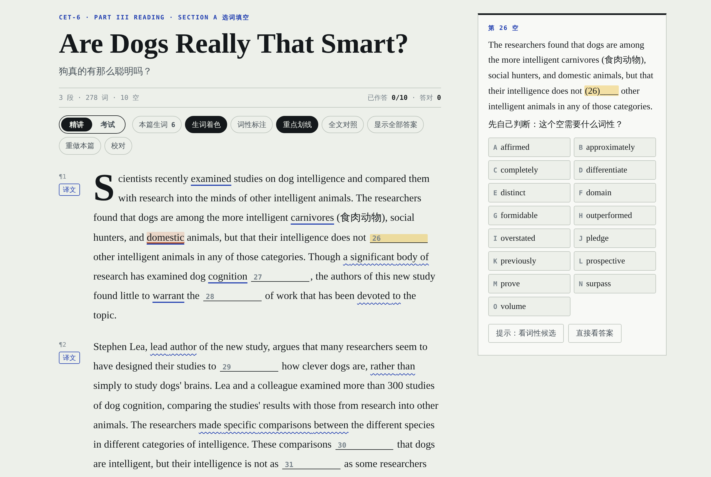
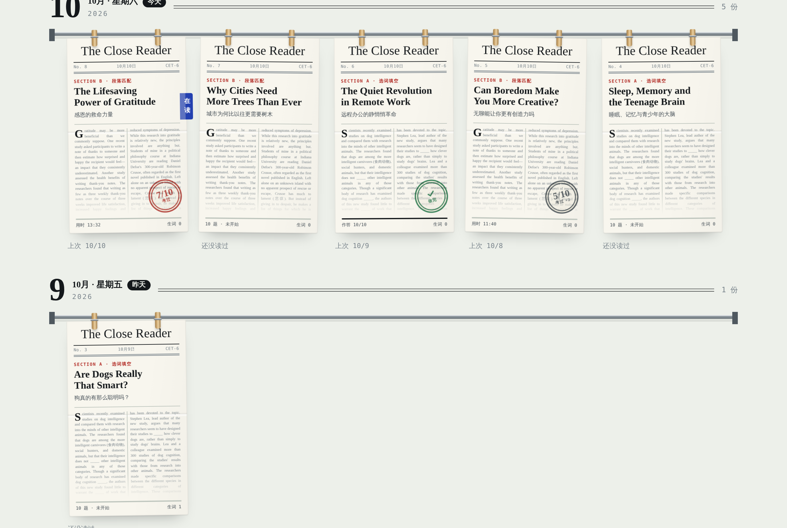
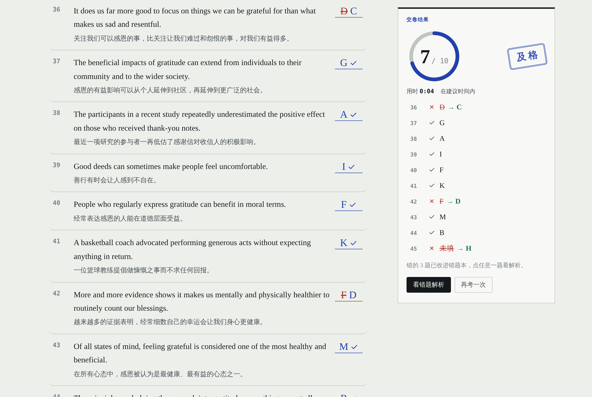
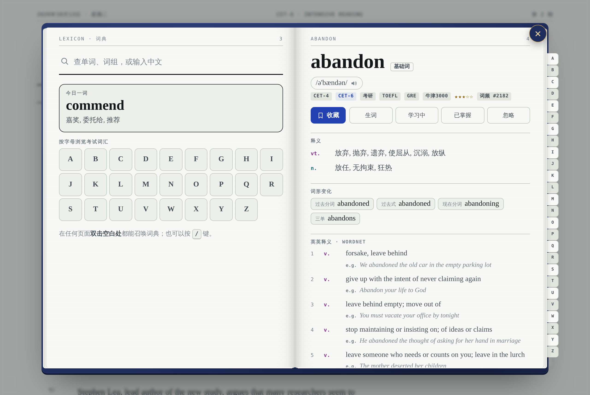
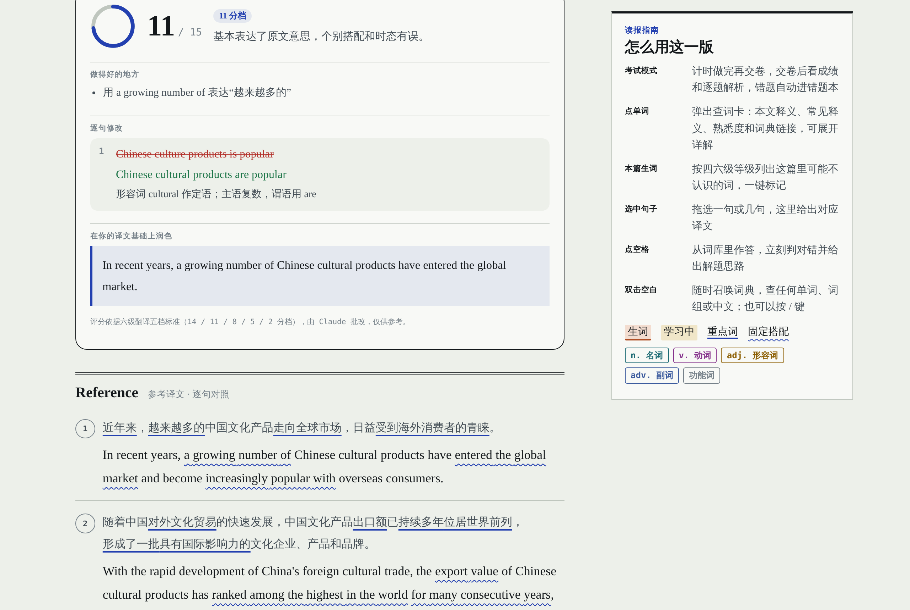
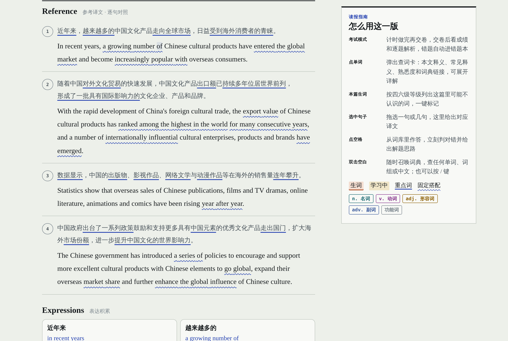
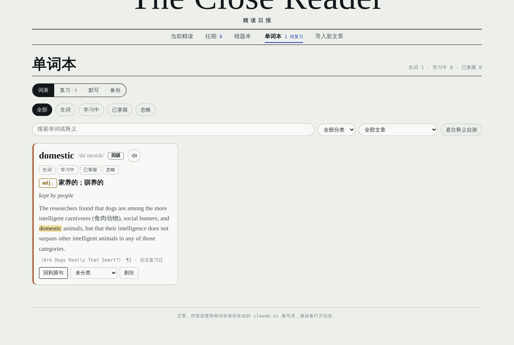
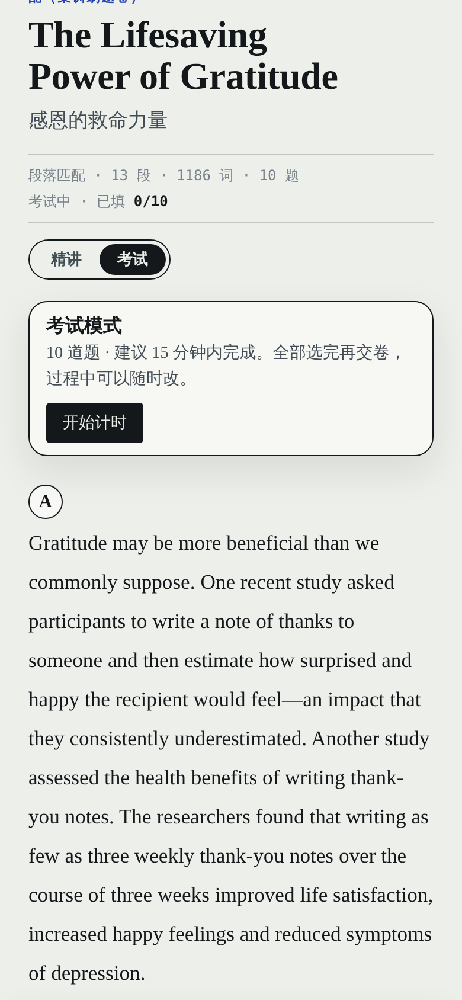

# The Close Reader · 精读日报

一个为英语六级阅读备考做的「报纸式」精读网页。每篇真题文章被整理成一份可以逐词点读的报纸：

- 点单词查释义，点空格看解题思路，选中句子看翻译；
- 翻译题可以直接在页面里写，交给 Claude 按六级五档标准打分、逐处改错，再对照参考译文；
- 做过的题、查过的词、错过的题，会自动沉淀成单词本、复习卡和错题本。

这个包是在 claude.ai 里迭代出来的完整工程，可以用两种方式运行：

| 形态 | 入口 | 存储 | AI 功能（拍照导入、AI 讲解等） |
| --- | --- | --- | --- |
| **claude.ai Artifact**（目前在用的线上版） | `close-reader.html` | 用户自己的 claude.ai 账号（Artifact 数据库） | 由 claude.ai 运行时提供 |
| **独立部署版**（本包新增，用来本地调试 / 自己部署） | `index.html` + `runtime/` | 浏览器 IndexedDB（只在这台设备、这个浏览器里） | 需要自己起一个后端代理（`server/dev-server.mjs`） |

两种形态共用同一份源码（`src/`）和同一套词典数据，由 `src/assemble.py` 一次构建同时产出。



| 查词卡片 | 解题卡片 |
| --- | --- |
|  |  |

| 往期报亭 | 交卷结果（段落匹配） |
| --- | --- |
|  |  |

| 词典（双击空白召唤） | 词典（手机） |
| --- | --- |
|  |  |

| 汉译英：Claude 批改 | 汉译英：参考译文与表达 |
| --- | --- |
|  |  |

| 错题本 | 单词本 | 手机 |
| --- | --- | --- |
|  |  |  |

---

## 目录

1. [部署与调试（先看这里）](#1-部署与调试先看这里)
2. [功能一览](#2-功能一览)
3. [项目结构](#3-项目结构)
4. [开发流程：改代码 → 构建 → 测试 → 发布](#4-开发流程改代码--构建--测试--发布)
5. [实现路径（架构）](#5-实现路径架构)
6. [数据格式](#6-数据格式)
7. [设计规范](#7-设计规范)
8. [注意事项与踩过的坑](#8-注意事项与踩过的坑)
9. [开发记录与关键决策](#9-开发记录与关键决策)
10. [第三方数据与许可](#10-第三方数据与许可)
11. [路线图](#11-路线图)

---

## 1. 部署与调试（先看这里）

### 1.1 环境要求

| 用途 | 需要 |
| --- | --- |
| 只是打开看、调试界面 | 任意静态文件服务器：Python 3 或 Node 18+ 二选一 |
| 重新构建页面 | Python 3.8+（如果装了 Node，构建时会顺便做语法检查） |
| 开启 AI 功能 | Node 18+，以及一个 Anthropic API Key |
| 跑端到端测试 | Python 包 `playwright`，加上 Chromium（`pip install playwright && python -m playwright install chromium`） |

页面本身**没有任何 npm 依赖、不需要打包工具**，克隆下来就能跑。

### 1.2 三十秒跑起来

```bash
cd close-reader

# 方式 A：Python 静态服务
python3 -m http.server 8080
# 方式 B：Node 开发服务器（同时提供 /api/sample 代理，见 1.3）
node server/dev-server.mjs

# 打开 http://localhost:8080/
```

第一次打开时会自动导入 `seeds/` 里的五篇示例文章：选词填空、段落匹配各一篇，仔细阅读两篇（Passage One / Two），汉译英一篇。之后的作答、单词、错题都存在浏览器的 IndexedDB 里，刷新也不会丢失。

> ⚠️ **不能直接双击 `index.html`**。词典用 `fetch` 按需加载，`file://` 协议下会失败，必须通过 http 服务访问。

想从零开始调试，有两个办法：
- 在 `runtime/config.js` 里取消注释 `window.CLOSE_READER_SEED = false`；
- 或者在浏览器开发者工具里删掉名为 `close-reader` 的 IndexedDB。

### 1.3 开启 AI 功能（拍照导入、AI 讲解、按语境释义、翻译批改）

在 claude.ai 里，这些功能由 Artifact 运行时直接调用 Claude。独立部署版走自己的接口 `/api/sample`（`api/sample.js`，Vercel 云函数），默认接 **DeepSeek**（`deepseek-flash`，能看图）。**API Key 只放在服务器的环境变量里，绝不写进前端或提交到 Git。**

两种用法，同一个接口：

| | 免费试用 | 用户自带 Key |
| --- | --- | --- |
| 谁的 Key | 站长的 `DEEPSEEK_API_KEY` | 用户在导入页底部「AI 设置」里填的 Key，只存在他自己的浏览器里 |
| 限额 | 每台设备**一次性** 2 篇导入 + 20 次小功能；同一 IP 每天 40 次；全站每天 150 次 | 每台设备每小时 120 次（防止接口被当中转站） |
| 支持的平台 | DeepSeek | DeepSeek、通义千问、Kimi、智谱、豆包（固定白名单，不能转发到别处） |

导入一篇文章要调两次模型（整理全文 + 逐词标词性）。免费导入成功后会发一张一次性通行证，第二次调用凭它免费，所以"一篇"只扣一次额度。

**线上配置（Vercel → 项目 → Settings → Environment Variables）：**

| 变量 | 说明 |
| --- | --- |
| `DEEPSEEK_API_KEY` | 免费试用用的 Key。不设置则只能用自带 Key |
| `KV_REST_API_URL` / `KV_REST_API_TOKEN` | 额度计数用的 Upstash Redis，在 Vercel 的 Storage / Marketplace 里接入后自动生成。**没有它，免费试用自动关闭**（绝不会变成无限制） |
| `FREE_IMPORTS` `FREE_SMALL` `IP_DAILY` `GLOBAL_DAILY` `BYOK_HOURLY` | 可选，覆盖上面的默认限额 |

`vercel.json` 把云函数放在香港节点（`hkg1`），最长运行 300 秒。照片在浏览器里先压缩到长边 2000 像素的 JPEG 再上传，避开 Vercel 每次请求 4.5MB 的上限。

**本地调试：**

```bash
CR_DEV_MEMORY=1 DEEPSEEK_API_KEY=sk-... node server/dev-server.mjs   # 计数存在内存里，重启清零
python3 tests/e2e_ai.py                                            # 假模型 + 假 Redis，26 项检查
```

接口协议：

```
GET  /api/sample                → { free: { enabled, importsLeft, smallLeft }, providers: [...] }
POST /api/sample
请求头  X-CR-Device（必填，浏览器随机生成）· X-CR-Provider / X-CR-Key / X-CR-Model（自带 Key 时）· X-CR-Ticket
请求体  { "prompt": "…", "images": ["data:image/jpeg;base64,…"], "modelTier": "default" | "complex" | "quick" }
响应    模型输出解析后的 JSON，HTTP 200；响应头 X-CR-Free: 剩余导入,剩余小功能
错误    { "error": 代码 }：402 free_used_up / no_balance · 401 bad_key · 429 rate_limited / busy_today
        · 413 prompt_too_large · 422 invalid_json · 502 model_rejected / upstream_error · 503 ai_unavailable
流式    请求体加 "stream": true（页面传了 onText 时自动加）：返回 text/plain，先是模型边写边发的原文，
        最后是 "\u0001" + {"value": 解析后的 JSON} 或 "\u0001" + {"error": 代码}
```

导入时页面用流式结果画「编辑部 · 正在排版」进度卡：读取原文 → 翻译 · 解析（每写好一句英文原句就排进校样）→ 标注词性（按已知词表计数）→ 排版完成。全部是真实进度，没有假动画；系统开启「减少动态效果」时动画全部关闭。用户点「停止」或关掉页面，服务器会中止对模型的调用并退回这次的免费额度。

Vercel 免费版一次函数调用最长 300 秒。按示例文章估算，最长的一篇要输出约 7000 token；如果遇到超长文章超时，见第 19b 条的处理方案。

### 1.4 部署到线上

- **纯静态托管**（GitHub Pages、Netlify、Vercel 静态站、对象存储都行）：把仓库根目录原样上传即可，入口是 `index.html`。词典数据约 69MB（核心 18MB + 扩展 42MB + 详解 8.7MB），全部分片懒加载、用到才下载，首屏只加载页面（约 250KB）和等级表 `level.json`（约 680KB）。
- **需要 AI 功能**：部署到 Vercel 时 `api/sample.js` 会自动成为云函数，按 1.3 配好环境变量即可。换成别的平台，需要一个实现同样协议的函数。
- **国内访问**：页面从 Google Fonts 加载字体。`index.html` 里这条样式表是非阻塞加载的（`media="print"` + `onload`，由 `src/assemble.py` 生成），字体服务器卡住时页面先用系统衬线字体（宋体 / Georgia）显示，不会白屏等待；实测模拟字体请求挂起 12 秒，首屏从 12.4 秒降到 0.2 秒。如果想要稳定的视觉效果，可以把字体文件下载下来自托管，然后改 `src/base.html` 头部的 `<link>`。

### 1.5 调试小抄

| 想看什么 | 怎么看 |
| --- | --- |
| 当前状态 | 页面状态都在闭包里的 `S` 对象中。调试时可以在 `src/partD.js` 末尾临时加 `window.S = S`，构建后在控制台查看 |
| 数据库内容 | 开发者工具 → Application → IndexedDB → `close-reader` → `docs`，键就是文档路径（如 `words/abandon`） |
| 某个按钮触发了什么 | 找它的 `data-act="xxx"`，然后在 `src/partC.js` 里搜 `case 'xxx'` |
| 某块界面是谁画的 | 搜对应的 class，渲染函数都叫 `xxxHtml()`，样式按模块分在 `src/*.css` |
| 不连真实数据的界面调试 | `cd tests && python3 preview.py`，用的是内存假库，刷新即重置；加 `--stand` 会多 8 份报纸 |
| 手机布局 | 浏览器设备模拟选 390×844；硬性要求是不能出现横向滚动 |

---

## 2. 功能一览

### 2.1 四种题型

| 题型 | 文章里的样子 | 作答方式 |
| --- | --- | --- |
| **选词填空**（Section A，`type: "cloze"`，默认） | 正文中的 `{{26}}` 渲染成空格；文末是 15 个选项的词库，可按词性分组 | 点空格 → 在右栏（手机为底部抽屉）选词 |
| **段落匹配**（Section B，`type: "match"`） | 每段左侧有圆圈字母 A–M；文末是题目列表 36–45，每题右边一个空；最底下一排段落字母 | 点题目的空格 → 选段落字母；同一段可以重复选 |
| **仔细阅读**（Section C，`type: "mcq"`） | 正文后是题目 46–50 / 51–55，每题四个选项 A–D，右边有答题框 | 直接点选项；考试中再点一次可以取消，也可以选中答题框后按 A–D 键 |
| **汉译英**（Part IV，`type: "trans"`） | 上面是中文原文（重点表达带下划线），下面是带横线的答题纸 | 在答题纸里写译文，自动保存；写完交给 Claude 批改，或直接对照参考译文，见 2.10 |

还有一种「纯阅读篇」：没有 `blanks` 的文章，只有点读、翻译和生词功能。

### 2.2 阅读页（当前精读）

- **报头**：日期、星期、「第 N 期」，栏目标签可横向滑动；在手机上，两端有渐隐提示和箭头，拉过头会有回弹效果。
- **工具栏**
  - **精讲 / 考试**：切换作答模式，见 2.4。
  - **本篇生词**：按六级等级列出本篇可能不认识的词，可一键标为已掌握；人名会自动跳过。
  - **生词着色**：生词标橙色，学习中的词标黄色。
  - **词性标注**：在每个词下方标出 n. / v. / adj. / adv. 等，并按词性着色。
  - **重点划线**：重点词用蓝色实线，固定搭配用波浪线。
  - **全文对照**：显示整篇中文翻译。
  - **重做本篇**：需要点两次确认。
  - **校对**：打开文章编辑器，见 2.7。
- **段落译文**：每段左侧有「译文」按钮，单独展开该段的中文。
- **选中翻译**：用鼠标拖选或手指选中一句或几句，右栏显示对应的中文。
- **解题卡片**（精讲模式）：
  - 作答前：提示这个空需要什么词性，可以一键高亮候选选项，也可以直接看答案。
  - 作答后：显示对错、正确答案、解析、易错陷阱、可迁移的技巧和整句翻译，并给出「下一空」按钮。
  - 卡片底部有「答案或解析有误？去修改」，直接跳到编辑器里对应的那一题。
- **仔细阅读的解析卡**：
  - 显示原文定位（附中文），可以跳回原文；
  - 定位词和解题思路（同义替换）；
  - **逐项分析**：每个错误选项写明错在哪里，并标出干扰类型（偷换概念 / 无中生有 / 以偏概全 / 正反颠倒）；
  - 技巧，以及题干和选项的译文。
- **段落匹配的解析卡**：多出「原文定位」，引用答案所在的原句和中文。点「在文中查看这句」会跳回原文高亮那一句；在手机上会同时出现「↩ 回到第 N 题」浮动按钮。
- **技巧小结**：每篇文末有 3–5 条做题技巧。

### 2.3 悬浮查词卡

点正文、选项或单词本里的任何单词，都会在单词旁弹出一张卡片。

1. **本文释义**：这个词在这句话里的意思，来自文章的 `lex`；导入时由 Claude 按语境逐词标注。如果某个词没有标注，卡片里有「让 Claude 按语境释义」按钮。
2. **常见释义**：来自 ECDICT 的中文义项，本句的词性排在最前面。
3. **英英释义**：来自 Open English WordNet，默认显示 4 条，可以展开全部；带例句。
4. **音标**：英式和美式 IPA，点击用浏览器朗读。
5. **标签**：CET-4、CET-6、考研、IELTS、TOEFL、GRE 等考试标签，柯林斯星级，牛津 3000，以及两套词汇等级：CEFR（A1–C2，国际通用）和考试词表（基础、四级、六级、考研、雅思托福、GRE）。两张表都没收的词不再标「超纲」：大写开头的是「专有名词」，其余按语料库词频标「高频 / 中频 / 低频词」（见 6.3）。
6. **词形还原**：例如「examined → 原形 examine · 过去式」。
7. **操作**：发音、收藏到单词本、选择分类或新建分类，以及把熟悉度设为生词、学习中、已掌握或忽略。
8. **外部词典链接**：剑桥词典、有道、YouGlish 真人发音。
9. **展开详解**：
   - 词源（Webster 1913 / GCIDE）
   - 词根词缀
   - 近义词（附中文）
   - 形近词（只差 1–2 个字母，并标红差异处）
   - 近义词辨析组
   - AI 讲解（Claude 生成词源故事、记忆法、常见搭配、例句和易混词，结果会保存下来）

   在详解里点近义词或形近词可以继续查，卡片顶部会出现「← 返回」按钮。
10. **位置**：桌面端卡片优先出现在单词下方，空间不够时放到上方；手机上如果下方空间不足，会先把单词滚到靠上的位置。

### 2.4 考试模式

- 新文章默认进入考试模式。建议用时：选词填空 10 分钟，段落匹配 15 分钟。计时环会显示进度。
- 考试中锁定查词，点单词会提示并轻轻抖动；解析也全部隐藏。
- 作答方式：
  - 选中一个空后，可以在右栏点选，也可以直接按键盘字母（选词填空 A–O，段落匹配 A–M），填完自动跳到下一空。
  - 段落匹配允许同一个字母用多次，段落字母上会显示已经选了几次。
- 切到别的标签页、切走视图或锁屏时，计时会自动暂停。
- 交卷：如果还有空没填，需要点第二次才会交卷。交卷后显示分数环、「及格」印章、用时，以及每一空的对错；正文里的答案会依次翻牌揭晓。
- 每次考试记录在 `attempts` 里，最多保留 30 次。可以「再考一次」。

### 2.5 错题本

交卷后，答错和没作答的题会自动收进错题本；精讲模式下选错或点了「直接看答案」也会收进来。每道题自动归类：

| 类型 | 判定 | 题型 |
| --- | --- | --- |
| 词性判断 `pos` | 选项词性 ≠ 答案词性 | 选词填空 |
| 词形 / 时态 `form` | 词性相同，但形式（过去式、复数等）不同 | 选词填空 |
| 语义辨析 `sense` | 词性和形式都对，意思选错 | 选词填空 |
| 相邻段混淆 `near` | 选的段和答案段相邻 | 段落匹配 |
| 定位错段 `loc` | 选的段离答案段更远 | 段落匹配 |
| 偷换概念 `swap` / 无中生有 `infer` / 以偏概全 `part` / 正反颠倒 `flip` | 取所选错误选项在 `ot` 里标注的干扰类型 | 仔细阅读 |
| 没有作答 `blank` | 空着 | 两者都有 |

- 顶部是按类型统计的条形图，点击可以筛选；下面会针对错得最多的类型给出一条建议。
- 每道错题可以在卡片里重做，选对后标为「已掌握」；也可以回到原题。

### 2.6 单词本

- **词表**：按熟悉度、分类、来源文章筛选，支持搜索。每个词都带着原句，点「回到原句」会跳回文章里那一句。可以遮住释义来自测。
- **复习**：用 FSRS-4.5 安排间隔（权重是官方默认值）。
  - 先看单词和原句，按空格或 Enter 翻面。
  - 用 1–4 打分（忘了 / 模糊 / 记得 / 简单），每个按钮下都显示下次复习的间隔。
  - 每天新词上限可选 10 / 20 / 30 / 50。
- **默写**：看中文和挖空的原句，拼写单词。拼错时逐字母标出差异。范围可以选生词 + 学习中、全部，或某个分类。
- **备份**
  - 导出 JSON：文章、进度、单词、分类和 AI 讲解全部打包。
  - 导出 Anki CSV：字段依次是单词、音标、词性、中文、英文、原句、等级、熟悉度、分类。
  - 从 JSON 恢复：只补缺不删除；同一个单词保留更新时间更晚的那份。

### 2.7 导入新文章与校对

- **导入**：拍照或粘贴文本都可以，题目选项和答案是可选输入。Claude 分两步整理：
  1. 生成文章结构，包括逐句翻译、选项、答案、解析、重点词和技巧。
  2. 逐词标注词性和语境释义。

  导入完成后会自动打开校对页。导入时 Claude 能识别段落匹配题型。
- **校对（编辑器）**：可以修改每个空的答案、解题要点、解析、陷阱和技巧；选词填空可以改选项，段落匹配可以改题目中英文和答案段落。

### 2.8 往期报亭

- 文章按**加入日期**分组。每一天有一个日期标题（大号日数、月份、星期、今天 / 昨天 / 前天、几份），下面是一根挂报纸的横杆。
- 每篇文章是一张缩小的头版：
  - 报头、期号、日期、题型；
  - 标题、中文副标题；
  - 两栏原文，带首字下沉，空格处显示成下划线，不会露出答案；
  - 对折折痕；
  - 进度条和生词数。
- **印章和便签**：考过的文章盖红色分数章，分数低于 60% 时为灰色；练习模式全部做完的盖绿色「做完」章；正在读的那篇侧边伸出蓝色「在读」便签。
- **动效**：进入时报纸依次落到杆上摆动停稳；鼠标悬停时轻晃；点击后像被取下来一样飘走，然后打开文章。
- 删除按钮在报纸下方，需要点第二次确认；桌面端鼠标悬停时才显示。

### 2.9 词典（双击空白召唤 + 顶部「词典」栏目）

**召唤方式**：
- 在任何页面**双击空白处**召唤词典；手机上双击空白处也可以。
- 按 `/` 或 `Ctrl/⌘ + K` 也可以打开。
- 查词卡底部的「在词典中打开 ↗」会直接翻到这个词。
- 「空白」的判断方式：用 `caretPositionFromPoint` 检查双击点下面是不是真的有字。所以双击单词仍然是浏览器默认的选词，不会召唤词典。
- 考试中不能召唤，会提示「交卷后再查」。

**动效：一本精装词典**：
- **打开**：合着的书从双击的位置飞出来，到屏幕中央停稳。接着烫金封面绕书脊翻开（3D `rotateY`），露出衬页，最后才看到左右两页。
- **翻页**：每查一个新词，右页像纸一样掀起翻到左边，带纸页阴影；点「← 返回」时，上一页会从左边翻回来。
- **合上**：封面先合上，然后整本书缩回原来的位置。
- **顶部栏目**：「词典」栏目里，这本书摊在页面上，进入栏目时同样有翻开封面的动画。
- **手机**：变成单页的书，封面以左边缘为轴翻开。

**左页（检索）**：
- 输入英文时，有前缀联想，用 ↑↓ 选择、Enter 查看，联想按 COCA 词频排序。
- 支持词组，例如 `give up`、`in terms of`。
- 输入中文时做汉英反查，范围是考试词汇。
- 拼错时会给出纠正，例如 `recieve → receive`；拼写距离允许增、删、改和相邻两个字母互换。
- 不输入时显示今日一词、最近查过，以及 A–Z 考试词汇浏览。
- 书页右侧切出了一排 A–Z 的拇指索引。

**右页（词条）**：
- 词头、英美音标（可以分别朗读），等级和考试标签，柯林斯星级、牛津 3000、COCA 词频。
- 收藏和熟悉度，和单词本是同一套数据。
- 全部中文义项、词形变化（可点击）、全部英英释义和例句。
- **在你读过的文章里**：列出这个词在你导入过的文章里出现的原句，点击直接跳过去。
- 词源、词根、近义词、近义辨析、形近词，以及 AI 讲解（复用查词卡的详解）。
- 剑桥、牛津高阶、韦氏、柯林斯、朗文、Etymonline、有道、YouGlish 八个权威在线词典的链接。
- 页脚注明每部分数据的出处。

**收录**：约 69 万词条。
- 核心 8.7 万词：来自 ECDICT 和 WordNet 的完整数据，包括英英释义、例句和音标。
- 扩展 60 万条：ECDICT 收录的其余全部词条，包括词组、专业词和较新的词。
- 37 个 ECDICT 未收的新词（如 blockchain、metaverse、deepfake），由编者补充，词条上会标出「新词 · 编者补充」。
- 本地查不到时，提示用户去权威在线词典查。

### 2.10 汉译英（翻译题）

**页面结构**（从上到下）：
1. **中文原文**：整段排版，`expr` 里的重点表达带铅笔色下划线。点一下，右栏（手机为底部抽屉）弹出这个表达的卡片：推荐译法、可替换说法、用法提醒，可以「收进单词本」。
2. **答题纸**：带横线的大输入框。输入停顿 0.7 秒后自动存进 `progress`，换设备、刷新都不丢；右上角实时显示词数。
3. **按钮**：「交给 Claude 批改」（只有运行时提供 `sample` 能力时才出现，译文要满 20 个词）和「对照参考译文」。
4. **批改卡**（批改后出现）：
   - 分数环（满分 15）和档位，按六级官方五档：14 / 11 / 8 / 5 / 2 分档；
   - 一句总评、做得好的地方；
   - 逐处改错：原文划掉 → 改法 → 为什么（中文）；
   - 一版在你的译文基础上润色的「改写版」，不是直接换成参考译文。
5. **参考译文**：逐句中英对照。英文句子和阅读页一样可以逐词点读、查词、收词。
6. **重点表达**：网格卡片，和原文下划线是同一套数据。
7. **技巧**：这篇的翻译技巧小结。

**批改的实现**（`trGrade`）：把原文、参考译文、重点表达和学生译文一起交给 Claude，要求只输出 JSON：
`{ score, band, summary, good[], fixes[{orig, fix, why}], polished }`。结果存进 `progress/<id>.review`，同时追加一条 `attempts`（`total: 15`），所以往期报亭的印章会显示「11/15 批改」。可以改完再批，每次覆盖上一次的批改。

**没有 AI 的时候**：「交给 Claude 批改」按钮不显示，「对照参考译文」变成主按钮。写译文、自动保存、参考译文、重点表达都照常可用。

**和其他题型的区别**：
- 不进考试模式，没有计时和交卷；
- 不产生错题本记录，批改结果本身就是复盘材料；
- 往期报亭里，报纸摘要显示中文原文的开头，栏目标为「Part IV · 汉译英」。

---

## 3. 项目结构

```
close-reader/
├── index.html               ← 构建产物：独立部署版入口（页面 + runtime/）
├── close-reader.html        ← 构建产物：claude.ai Artifact 版（同一页面，不含 runtime）
├── runtime/
│   ├── config.js            ← 部署配置（AI 代理地址、是否导入示例），手动编辑，构建不会覆盖
│   └── local-runtime.js     ← 在 claude.ai 之外模拟 window.claude：IndexedDB 存储、文件下载、AI 代理
├── server/
│   └── dev-server.mjs       ← 零依赖 Node 服务：静态文件 + /api/sample → Anthropic Messages API
├── level.json               ← 考试词表等级（36k 词形）
├── cefr.json                ← CEFR 等级（A1–C2，约 8.8k 词，tools/build_cefr.py 生成）
├── dict/a.json … z.json     ← 核心词典源数据（8.7 万词：ECDICT 中文 + WordNet 英英 + IPA + 词形变化 + 词频），共 18MB，不上线
├── dict/b/                  ← 页面实际读取的核心词典：159 个约 120KB 的有序分卷 + index.json（tools/split_dict.py 生成）
├── dict/zh.json             ← 汉英反查索引（1.4 万个考试 / 常用词）
├── ext/000.json … 052.json  ← 扩展词库（60 万条：词组、专业词、新词），按字母顺序切成 53 个约 1MB 的分卷，共 42MB
├── ext/index.json           ← 分卷目录：[[起始两个字母, 文件名]…]
├── more/a.json … z.json     ← 详解源数据（词源、词根、近义词、形近词），共 8.7MB，不上线
├── more/b/                  ← 页面实际读取的详解：83 个有序分卷 + index.json
├── more/resemble.json       ← 近义词辨析组（1331 组）
├── src/                     ← 唯一需要编辑的源码
│   ├── assemble.py          ← 构建脚本：base.html + 各模块 → close-reader.html 和 index.html
│   ├── base.html            ← 最初的单文件版本：基础 CSS、HTML 骨架、第一代 JS（阅读、词典、导入）
│   ├── partB.js             ← 写入队列、单词仓库、视图渲染、阅读页、悬浮卡、FSRS、单词本
│   ├── partC.js             ← 事件委托（所有 data-act 动作）、键盘、滚动、Claude 查词
│   ├── partD.js             ← 启动：连接运行时、订阅数据库、迁移旧数据
│   ├── partE.js             ← 考试引擎、错题本、文章编辑器、共享工具函数
│   ├── match.js / .css      ← 段落匹配题型
│   ├── mcq.js / .css        ← 仔细阅读题型（四选一、逐项分析）
│   ├── trans.js / .css      ← 汉译英题型（答题纸、自动保存、Claude 批改、参考译文、重点表达）
│   ├── stand.js / .css      ← 往期报亭
│   ├── dict.js / .css       ← 词典：双击召唤、翻书动效、检索、词条页、扩展词库查询
│   ├── tabs.js / .css       ← 栏目标签的滚动提示与回弹
│   ├── extra.css            ← 悬浮卡、单词状态、单词本、滚动条
│   └── extra2.css           ← 动效系统、考试条、模式切换、结果卡、错题本、编辑器
├── seeds/                   ← 示例文章（和线上数据库里的文档一致）
│   ├── seed-dog.json        ← 选词填空：Are Dogs Really That Smart?
│   ├── seed-gratitude.json  ← 段落匹配：The Lifesaving Power of Gratitude
│   ├── seed-ai-judgment.json ← 仔细阅读：Technology Is Never a Neutral Tool（46–50）
│   ├── seed-reading-wars.json ← 仔细阅读：America's Reading Wars（51–55）
│   ├── seed-cn-culture.json  ← 汉译英：中国文化产品走向全球
│   └── seed-gratitude.base.json ← 上一篇的中间产物（还没有逐词释义）
├── tools/
│   ├── build_dict.py        ← 从 ECDICT 生成扩展词库、汉英索引，并给核心词典补词形 / 词频
│   ├── newwords.json        ← 编者补充的新词（ECDICT 未收）
│   ├── build_gratitude.py   ← 手工整理一篇文章的范例脚本 → seeds/seed-gratitude.json
│   ├── build_ai_judgment.py / lex_ai_judgment.py ← 仔细阅读 Passage One 的整理脚本与逐词释义
│   ├── build_reading_wars.py / lex_reading_wars.py ← 仔细阅读 Passage Two
│   ├── build_translation.py ← 汉译英那篇（句子、参考译文、重点表达、逐词释义都在一个脚本里）
│   └── lex_gratitude.py     ← 该篇的逐词释义、重点词、技巧
├── tests/
│   ├── harness.py           ← 本地静态服务，把页面包装成 claude.ai 的样子
│   ├── stub-db.js           ← window.claude 的内存替身（不落盘，测试用）
│   ├── preview.py           ← 用内存替身预览界面
│   ├── e2e_match.py         ← 段落匹配全流程 + 选词填空回归（桌面 + 手机）
│   ├── e2e_stand.py         ← 往期报亭（桌面 / 手机 / 深色）
│   ├── e2e_mcq.py           ← 仔细阅读：考试作答 / 键盘 / 交卷 / 逐项解析 / 错题分类与重做 / 编辑器
│   ├── e2e_dict.py          ← 词典：召唤、考试禁用、联想、词组、新词、汉英、纠错、翻页、熟悉度、关闭、栏目页
│   ├── e2e_local.py         ← 独立部署版：自动导入示例、刷新后数据还在、导出下载
│   ├── e2e_trans.py         ← 汉译英：自动保存、批改（假 Claude）、参考译文、重点表达、收词、报亭印章；顺带做 Passage Two
│   └── screenshots.py       ← 重新生成 docs/img 截图
├── docs/img/                ← README 截图
└── build/check.js           ← 构建时导出的页面脚本，用于 node --check（已在 .gitignore 中）
```

---

## 4. 开发流程：改代码 → 构建 → 测试 → 发布

### 4.1 构建

```bash
python3 src/assemble.py
# → close-reader.html   （Artifact 版）
# → index.html          （独立部署版：在 <head> 里先加载 runtime/config.js 和 runtime/local-runtime.js）
# → build/check.js      （页面脚本单独导出；装了 node 会自动跑 node --check）
```

**所有修改都在 `src/` 里做**，然后重新构建。两个 `.html` 都是构建产物，手改会被下次构建覆盖。只有 `runtime/` 和 `server/` 是直接编辑的。

### 4.2 测试

```bash
cd tests
python3 e2e_match.py     # 段落匹配：考试、键盘作答、交卷、解析、原文定位、错题分类与重做、编辑器；选词填空回归
python3 e2e_stand.py     # 往期报亭：按天分组、印章、在读便签、删除确认、打开文章、无横向溢出
python3 e2e_mcq.py       # 仔细阅读：作答、交卷、逐项解析、错题、编辑器
python3 e2e_dict.py      # 词典：双击召唤 / 考试禁用 / 联想 / 词组 / 汉英 / 纠错 / 翻页 / 熟悉度 / 栏目页
python3 e2e_local.py     # 独立部署版：IndexedDB 持久化、导出下载、没配置 AI 时的提示
python3 e2e_trans.py     # 汉译英：草稿自动保存、批改卡、参考译文、表达卡、收词；Passage Two 满分作答
python3 screenshots.py   # 重新生成 README 截图
python3 preview.py       # 手动预览（内存假库），--stand 会多 8 份报纸
```

测试会打印关键状态，最后一行是 `errors: []`。截图保存在 `tests/shots/`。打包前三个测试都通过了。沙箱里加载 Google Fonts 失败产生的 `ERR_TUNNEL_CONNECTION_FAILED` 可以忽略。

**改动后至少跑一遍** `e2e_match.py` 和 `e2e_stand.py`：一个覆盖两种题型的核心流程，一个覆盖动效最多的页面。

### 4.3 发布回 claude.ai（线上版）

线上版是 claude.ai 里的一个 Artifact，标题 *The Close Reader*，私有。

- **发布页面**：在 Claude 对话里，用 Artifact 工具发布 `close-reader.html` 到同一个 Artifact 地址。
- **数据文件**：`dict/`、`more/`、`level.json` 已经作为附带文件上传过，共 55 个。只改页面时不用重传；只有词典数据变了，才在发布时通过 `files` 一并更新。
- **运行时能力**：`db`（数据库）、`sample`（调用 Claude；拍照导入需要开启 `images: true`）、`downloads`（导出文件）。重新发布时不传 `capabilities`，会沿用原有设置。
- **示例文章**：写在数据库 `articles` 集合里，doc id 就是文章的 `id`。

**多个对话同时改同一个 Artifact 会冲突**。别的对话发布过之后，你这边再发布会被拒绝，并返回差异。正确做法是：

1. 把差异**合并进 `src/` 的对应文件**。例如标签栏的滚动提示功能，就是从线上差异里拆出来放进 `tabs.js` 和 `tabs.css` 的。
2. 重新构建。
3. 再发布。

绝对不要直接在产物上改。

---

## 5. 实现路径（架构）

### 5.1 总体形态

```
src/base.html ───────┐                  ┌─► close-reader.html ──► claude.ai Artifact（运行时由 claude.ai 提供）
partB/C/D/E.js ──────┤                  │
match / stand / tabs ┼── assemble.py ───┤
extra*.css ──────────┘                  └─► index.html ─ runtime/config.js + runtime/local-runtime.js
                                                          （IndexedDB / 下载 / /api/sample → server/dev-server.mjs）
页面运行时：
  ├─ fetch dict/b/index.json → dict/b/NNN.json、more/b/NNN.json（按词所在分卷懒加载）、level.json
  └─ window.claude.use('db' | 'sample' | 'downloads')   ← 唯一的外部接口，见 5.10
```

- **零依赖**：没有框架、没有构建工具链，也没有 npm 包。所有逻辑在一个立即执行函数 `(() => { … })()` 里。外部资源只有 Google Fonts。
- **构建方式**：`assemble.py` 以 `base.html` 为底，按注释标记切出几段（例如 `/* ---------- import`、`/* ---------- actions`），换成新模块，再做一些「锚点替换」补丁。**每个补丁都断言锚点只出现一次**，所以构建失败通常意味着锚点文字变了。这时去改锚点，不要改产物。

### 5.2 状态与渲染

- **全局状态 `S`**：当前视图、当前文章、作答进度、单词、错题、面板、弹窗栈、考试计时等，全部放在一个对象里。
- **渲染方式**：渲染函数直接拼 HTML 字符串，赋值给 `innerHTML`。
  - `renderChrome()`：栏目标签上的计数。
  - `renderView()`：主视图（阅读 / 往期 / 错题 / 单词本 / 编辑器 / 导入）。
  - `renderPanel()`：右栏或手机底部抽屉。
  - `renderPop()`：悬浮查词卡。
  - `afterReadRender()`：阅读视图渲染之后的补充工作，例如考试条和揭晓动画。
- **事件委托**：所有可点元素都写成 `data-act="动作名"`，由 `partC.js` 里唯一的 `click` 监听器用 `switch` 分发。新增交互时，加一个 `data-act` 和一个 `case` 即可。
- **自定义属性**：`data-n`（题号）、`data-l`（选项字母）、`data-p` / `data-s`（段落和句子下标）、`data-id`（文章 id）。
- **进入动画**：切换视图时设置 `S.enter = true`，`renderView()` 会给视图加上 `.enter` 类来播放入场动画。往期报亭只在这一刻挂上 `.swing`，所以删除确认之类的重绘不会让报纸重新摆一遍。

### 5.3 持久化

- **写入队列**：`write(path, fn)` 对同一路径的写操作排队执行，失败时用 toast 提示，并把 `quota_exceeded`、`invalid_argument` 等错误码翻译成中文。
- **订阅**：启动时（`partD.js`）订阅 `articles`、`progress`、`words`、`mistakes`、`notes`、`meta/settings` 和旧的 `vocab` 集合。
- **防重绘**：收到快照时先用 `canon()` 深比较；如果和本地状态相同（也就是自己刚写进去的），就跳过重绘，避免输入或动画被打断。
- **doc id 规范**：只允许 `[A-Za-z0-9_\-.~:@+]`，最长 180 个字符。
  - 单词用 `wdoc()` 生成 id。
  - 错题用 `mkId()` 生成，格式是 `文章id~题号`。
  - AI 讲解按词元做同样的清洗。
- **旧数据迁移**：
  - `migrateVocab()`：把第一代单词本 `vocab/*` 迁移进 `words/*`。
  - `repairCtx()`：修复早期把 `____` 存进例句的问题，改用 `fullSent()` 填入正确答案后的整句。

### 5.4 词典查询链

```
点击单词 → 规范化（小写、去掉 's）
        → dict/<首字母>.json 里有？
            ├─ 有，且是变形（l 字段）→ 取原形条目，记下变形类型（f：p 过去式 / d 过去分词 / i 现在分词 / 3 三单 / s 复数 / r 比较级 / t 最高级）
            ├─ 有，且带 x 字段，同时本句词性是过去式、复数等 → 用 x 指向的原形
            └─ 没有 → stems() 规则还原（-ies、-ied、-ing、双写辅音……）再查
        → 还没有 → ext/index.json 找到分卷 → ext/<分卷>.json（词组、专业词、新词）
        → 中文义项按本句词性（ctxKey）排序，英英释义同样排序
展开详解 → more/<首字母>.json[原形] + more/resemble.json[g 下标]
等级     → level.json（">lemma" 表示变形指向原形）+ cefr.json（先查原词，再查原形，再按 -s/-ed/-ing 还原）
```

查一个词只下载它所在的那一个分卷（约 120KB，压缩后约 40KB），加载过的会缓存；每次下载 15 秒超时并自动重试一次，仍失败时卡片里有「重试」按钮。词典页按字母浏览、联想补全时，才并行下载这个字母的全部分卷。

> 以前是按首字母分片，`dict/s.json` 一个文件就有 2MB（压缩后约 700KB），查一个 s 开头的词要先下完它。在模拟的慢速手机网络（1.5Mbps、300ms 延迟）下，查一个新字母开头的词从 4.3 秒 / 715KB 降到 0.8 秒 / 41KB。

### 5.5 单词仓库

- **结构**：`S.words` 以原形为键。每个词带：
  - `forms`：已知的变形，加上 `inflect()` 推出的常规变形，最多 30 个；
  - `ctx`：出处原句，最多 6 条；
  - `status`、`cat`、`lvl`；
  - `srs`：FSRS 状态。
- **反查索引**：`S.formIdx` 把任意变形映射回原形。正文里「生词着色」和「本篇生词」都靠它判断。
- **自动补全**：用户手动设过的字段不覆盖；空着的字段（音标、英文释义、等级）在词典加载后自动补上（`fillMissing`）。

### 5.6 FSRS-4.5

原计划用 `ts-fsrs` 库，但沙箱访问不了 npm 和 jsDelivr，所以在 `partB.js` 里按 FSRS-4.5 公式自己实现：

- 权重 `FW` 是官方默认的 17 个参数，目标保持率 0.9。
- 新卡打「忘了」或复习时打「忘了」，10 分钟后再出现；其他情况按稳定度换算成天数。
- `fsrsPreview()` 保证四个按钮的间隔严格递增。

### 5.7 考试引擎（`partE.js`）

- **进度文档**：`progress/<文章id>` 的结构是 `{ mode, picks, shown, exam: { answers, elapsed, started }, attempts[], lastOpened }`。
- **计时**：`S.examRun` 记录本次开始的时刻和累计秒数，用 `examElapsed()` 计算。页面隐藏或离开阅读视图时 `examPause()` 把累计值写回。
- **交卷**：`examSubmit()` 计分；把作答写进 `picks`，没作答的标进 `shown`；追加一条 `attempts`；调用 `recordMistake()` 收错题；最后切回精讲模式并播放揭晓动画。
- **题型差异**：段落匹配的建议用时由 `targetOf()` 决定；同一个字母允许重复作答；错题分类走 `near` / `loc` 分支。

### 5.8 导入管线

1. 拍照或粘贴文本，调用 `S.sample.json(importPrompt, { images })`。提示词要求 Claude：
   - 逐字保留原文、按句切分、空格写成 `{{题号}}`；
   - 给出逐句翻译、选项（含词性和形式）、答案和四段解析（need / why / trap / tip）；
   - 挑出重点词和技巧；
   - 遇到段落匹配时按第 7 条规则输出 `type: "match"`、`label`、`items` 和 `loc`。
2. `normalize()` 清洗返回结果。段落匹配的文章会根据段落首句自动生成「选项」（字母 → 段落预览）。
3. `lexPrompt` 对全文逐词标注 `["词性", "中文", "English gloss"]`，用流式输出显示进度，结果写入 `lex`。
4. 生成文章 id，规则是「标题 slug-时间戳 36 进制」，写入 `articles/<id>`，然后打开编辑器让用户校对。

### 5.9 往期报亭（`stand.js` / `stand.css`）

- **分组**：按 `createdAt` 的本地日期分组，组内按时间倒序；期号 `No.` 按加入顺序编号。
- **横杆**：用 `repeating-linear-gradient` 画在 `.rack` 上，周期等于「一排的高度 + 行距」。所以每一排都有自己的杆和两端支架，不需要额外的 DOM。为此每排的高度是固定的，由 `--ph` 控制：桌面 318px，手机 252px。
- **字号**：报纸内的字号用容器查询单位 `cqw` 随报纸宽度缩放。
- **动效**：每份报纸的倾角 `--t` 和入场延迟 `--d` 写在内联样式里，摆动动画都相对 `var(--t)` 计算。

### 5.10 运行时适配层（独立部署的关键）

页面只通过 `window.claude.use(name)` 和外界打交道，用到的接口很少：

```ts
db.doc(path).set(data) / .update(partial) / .delete() / .onSnapshot(snap => …)
db.collection(path).onSnapshot(snap => …)
//  doc 快照:        { id, exists, data() }
//  collection 快照: { docs: [doc 快照…], size, empty }
//  update 是深合并：{ lex: { word: […] } } 只改 lex 里的这一项
sample.json(prompt, { images?: File[], modelTier?, signal?, onText? }) → 解析好的 JSON
downloads.save({ filename, data }) → { status: 'saved' }
//  错误统一抛 { code }：quota_exceeded / invalid_argument / rate_limited / invalid_json / cancelled …
```

- **claude.ai 里**：由 Artifact 运行时提供。
- **独立部署**：由 `runtime/local-runtime.js` 提供。
  - `db`：IndexedDB 单表，键是文档路径。启动时把整表读进内存镜像，所以快照是同步的；写入时先改内存、触发订阅，再落盘。
  - `downloads`：生成一个 Blob 并触发下载。
  - `sample`：只有在 `config.js` 里配置了代理地址时才存在。
- **测试里**：由 `tests/stub-db.js` 提供，只存在内存里。

以后接 Supabase 之类的云同步，只需要再写一个实现同样接口的适配层，页面代码不用动。

---

## 6. 数据格式

### 6.1 文章 `articles/<id>`

```jsonc
{
  "id": "gratitude-lifesaving",
  "type": "match",                 // "cloze"（默认）| "match" | "mcq" | "trans"
  "title": "The Lifesaving Power of Gratitude",
  "zh": "感恩的救命力量",
  "source": "CET-6 · Part III Reading · Section B 段落匹配",
  "createdAt": 1791612000000,      // 毫秒时间戳；往期报亭按它分天
  "paragraphs": [
    { "label": "A",                // 仅段落匹配
      "sentences": [ { "en": "原句，填空处写 {{26}}", "zh": "整句翻译（按正确答案翻）" } ] }
  ],
  "items": { "36": { "en": "题目原文", "zh": "题目翻译",            // 段落匹配 / 仔细阅读
               "o": { "A": { "en": "选项", "zh": "选项译文" } } } },  // 仅仔细阅读：A–D 四个选项
  "options": {                     // 选词填空：A–O；段落匹配：由段落自动生成
    "A": { "w": "affirmed", "pos": "v.（过去式）", "zh": "证实；断言（affirm）", "en": "stated or showed that something is true" }
  },
  "blanks": {
    "26": {
      "ans": "N",                  // 正确选项 / 段落字母
      "need": "这个空需要什么（词性 / 定位词）",
      "cands": ["D", "J", "M", "N"],  // 选词填空：同词性候选，用于「提示」
      "why": "解析", "trap": "易错陷阱", "tip": "可迁移技巧",
      "loc": [2, 3],               // 段落匹配 / 仔细阅读：答案句 [段落下标, 句子下标]
      "ox": { "B": "错因" },        // 仅仔细阅读：每个错误选项错在哪
      "ot": { "B": "swap" }        // 仅仔细阅读：干扰类型 swap / infer / part / flip
    }
  },
  "lex":  { "examined": ["v.（过去式）", "审视；研究（examine）", "looked at … carefully"] },  // 键为小写原词
  "keys": [ { "t": "anything but", "k": "phrase", "n": "绝不是；根本不" } ],   // t 必须是原文里连续出现的词
  "tips": [ "技巧 1", "技巧 2" ]
}
```

**汉译英（`type: "trans"`）** 复用同一个外壳，但含义不同：

```jsonc
{
  "id": "cn-culture", "type": "trans",
  "title": "Chinese Cultural Products Go Global", "zh": "中国文化产品走向全球",
  "paragraphs": [ { "sentences": [
    { "zh": "中文原句（题目）", "en": "这一句的参考译文" }      // 注意：这里 zh 才是原文
  ] } ],
  "expr": [ { "zh": "越来越多的",                             // 必须是原文里连续出现的片段，用来画下划线
              "en": "a growing number of",                   // 推荐译法
              "alt": "more and more / an increasing number of", // 可选：可替换说法
              "n": "a growing number of + 复数名词，谓语用复数。" } ],
  "options": {}, "blanks": {},                                // 留空
  "lex": {}, "keys": [], "tips": []                           // 作用于参考译文（英文），和其他题型一样
}
```

`progress/<id>` 对翻译题多出这些字段：`draft`（草稿全文）、`revealed`（是否展开了参考译文）、`review`（最近一次批改，结构见 2.10）、`attempts[{at, score, total: 15}]`。

### 6.2 数据库集合

| 路径 | 内容 |
| --- | --- |
| `articles/<id>` | 文章，见上 |
| `progress/<文章id>` | `mode`、`picks{题号:字母}`、`shown{题号:true}`、`exam{answers,elapsed,started}`、`attempts[{at,secs,score,total,picks}]`、`lastOpened` |
| `words/<wdoc(原形)>` | `w`、`forms[]`、`status`（new / learning / known / ignored）、`cat`、`pos`、`zh`、`en`、`ph`、`lvl`、`ctx[{art,title,p,s,text,at}]`、`srs{s,d,reps,lapses,last,due}`、`at`、`up` |
| `mistakes/<文章id~题号>` | `art`、`title`、`n`、`p`、`s`、`kind`（cloze / match / mcq）、`sent`、`pick`、`ans`、`pickW`、`ansW`、`type`、`times`、`at`、`last`、`resolved` |
| `notes/<原形>` | AI 讲解：`story`、`memory`、`collocations[]`、`examples[[en,zh]]`、`confusions`、`at` |
| `meta/settings` | `{ cats: [分类名…] }` |
| `vocab/*` | 第一代单词本，启动时自动迁移后删除 |

浏览器 `localStorage` 只存个人偏好，不存需要可靠保存的数据。包括：`showPos`、`showKw`、`hideZh`、`group`、`nwLvl`、`newLimit`、`newDay`。

### 6.3 词典分片

**`dict/<字母>.json`**（核心）和 **`ext/<分卷>.json`**（扩展）：`{ 词: 条目 }`，两者字段相同。扩展词库没有 `w`、`i`。字段如下：

| 字段 | 含义 | 来源 |
| --- | --- | --- |
| `t` | 中文义项，多行，每行以 `n.` / `vt.` / `a.` 等开头 | ECDICT |
| `p` | ECDICT 音标（后备） | ECDICT |
| `i` | `[英式 IPA, 美式 IPA]` | WordNet / Wiktionary IPA |
| `w` | `[[词性 n/v/a/r, 释义, 例句?]…]` | Open English WordNet |
| `d` | 旧版英文释义（没有 `w` 时使用） | ECDICT |
| `g` | 考试标签，空格分隔：`cet4 cet6 ky ielts toefl gre` | ECDICT |
| `c` | 柯林斯星级 1–5 | ECDICT |
| `o` | 牛津 3000 核心词（1） | ECDICT |
| `l` + `f` | 本词是变形：`l` 为原形，`f` 为变形码 | ECDICT exchange |
| `x` + `xf` | 本词既是独立词条，也可能是 `x` 的变形 | ECDICT exchange |
| `ex` | 本词的变形，如 `p:went/d:gone/i:going/3:goes` | ECDICT exchange |
| `fq` / `bn` | COCA / BNC 词频排名（越小越常用） | ECDICT |
| `s` | `"n"` 表示编者补充的新词 | tools/newwords.json |

**`ext/index.json`**：`{ v, n: 条目数, b: [[起始两个字母, 文件名]…] }`。查词时取单词的前两个字母，找到最后一个起始值不大于它的分卷。

**`dict/zh.json`**：`[[词, 中文简释, 等级, 词频]…]`，用于汉英反查。

**`more/<字母>.json`**：`{ 原形: 详解 }`。字段如下：

| 字段 | 含义 |
| --- | --- |
| `e` | 词源（GCIDE / Webster 1913，语言名已译成中文） |
| `r` | 词根词缀，格式 `[[成分, 含义, 类别, 来源语言]]` |
| `s` | 近义词，格式 `[[词, 词性, 中文]]` |
| `k` | 形近词，格式 `[[词, 中文, 差几处]]` |
| `g` | `resemble.json` 里的下标 |

**`more/resemble.json`**：`[[词组], "辨析说明"]` 的数组。

**`level.json`**：`{ 词形: 等级 | ">原形" }`。等级码为 `b` 基础、`4` 四级、`6` 六级、`k` 考研、`t` 雅思托福、`g` GRE；不在表里的词没有考试等级。

**等级怎么定**（`tools/build_dict.py` 里的 `level_of`，依据 ECDICT 的考试标签）：
1. 中考词汇（`zk`）定为基础词。
2. 否则按 四级 → 六级 → 考研 的顺序，取第一个收录这个词的考试。
3. 只在高考词汇（`gk`）里、大学考试都没收的词，也定为基础词。
4. 剩下的按 雅思托福 → GRE 归类。
5. 都没有就不给考试等级。

以前的规则是「高考或中考词汇一律算基础词」，结果 abandon、intelligence 这类四级核心词被标成了基础词，这次一共修正了 1706 个词。

这套等级依据的是 ECDICT 收录的考纲词表，版本较早，个别新进考纲的词可能偏高，例如 resilient 只被标了 GRE。

单词本里已保存的词，显示的是当前等级表的结果，不是保存时记下的旧值。

**`cefr.json`**：`{ "src": 来源说明, "A1": "a able about …", …, "C2": "…" }`，每个等级一串空格分隔的词（词组里的空格写成 `_`），约 75KB，和 `level.json` 一起加载；加载失败时只是不显示 CEFR，不影响别的。由 `python3 tools/build_cefr.py` 从 `tools/cefr/` 下的两张表生成：

- A1–B2：CEFR-J Wordlist 1.5（东京外国语大学投野由纪夫研究室），约 7,800 条；
- C1–C2：Octanove Vocabulary Profile C1/C2 1.0，约 2,100 条；
- 同一个词有多个词性时取最低的等级；`analyze/analyse` 这类拼写对拆成两条。

**卡片上的等级标签**（`partB.js` 的 `lvBadges`）按这个顺序决定：
1. CEFR 等级（A 绿、B 蓝、C 红）和考试等级，有哪个显示哪个，可以同时显示。
2. 两个都没有、而且在正文里是大写开头（不是全大写缩写），或者 AI 给的词性是人名 / 地名 → 「专有名词」。比如 Tokyo 以前会被标成「超纲」。
3. 否则看词典里的 COCA / BNC 词频排名：前 5,000 是「高频词」，前 20,000 是「中频词」，再往后是「低频词」；悬停能看到具体排名。
4. 连词频都没有（多半是拼写错误或很新的词），什么都不标。

「本篇生词」里，没有考试等级、但 CEFR 在 B1 及以下的词（比如 internet）不再算「可能不认识」。

**重新生成**：改了 `dict/<字母>.json` 或 `more/<字母>.json` 之后，运行 `python3 tools/split_dict.py` 重新切分卷（`build_dict.py` 结束时会自动调用它）。`tools/build_dict.py` 的用法写在脚本开头，它负责从 ECDICT 生成 `ext/`、`dict/zh.json`，并给核心词典补上 `ex`、`fq`、`bn`。脚本可以重复运行。

> ⚠️ 核心词典里的 WordNet 释义、音标，以及 `more/`、`level.json`，是在早期对话里一次性转换出来的，转换脚本没有保存。上面的字段说明足够重写。`build_dict.py` 只给这些文件补字段，不重建它们。

### 6.4 备份文件

```json
{ "app": "close-reader", "version": 2, "exportedAt": "…",
  "articles": [], "progress": {}, "words": [], "settings": { "cats": [] }, "notes": {} }
```

### 6.5 不用 AI，手动加一篇文章

1. 照着 `seeds/seed-dog.json`（选词填空）、`seeds/seed-gratitude.json`（段落匹配）、`seeds/seed-reading-wars.json`（仔细阅读）或 `seeds/seed-cn-culture.json`（汉译英）的结构写一个文章 JSON。字段说明见 6.1。必填的只有 `id`、`title`、`paragraphs`；`lex` 可以先空着，页面会退回到词典释义。
2. 把它包进备份文件的外壳：

   ```json
   { "app": "close-reader", "version": 2, "articles": [ { …文章… } ] }
   ```

3. 在页面里依次进入「单词本 → 备份 → 从备份恢复」，选择这个文件。恢复只会补充缺少的内容，同 `id` 的文章不会被覆盖。
4. 导入后，用「校对」检查答案和解析。

需要批量整理时，可以参考 `tools/build_gratitude.py`：用 Python 写好段落和解析，生成 JSON，再用同样的方式导入。

---

## 7. 设计规范

### 7.1 视觉概念

**一份报纸，加一支校对员的铅笔。**

- **版面**：报头用哥特体（UnifrakturMaguntia）。标题用 Old Standard TT 衬线体，正文用 Newsreader，中文用 Noto Serif SC。分隔线用细线、双线和粗线，信息密度向报纸看齐。
- **颜色的语义**：
  - **蓝色铅笔** `--pencil`：重点、答案、当前选中项和主要交互。
  - **红笔** `--red`：错误、删除、陷阱提示。
  - **黄色荧光笔** `--marker`：当前定位的词或句。
  - **手写体** Kalam：填进空格里的答案，像用铅笔写上去的。
- **报纸隐喻要贯彻到底**：往期是挂在杆上的报纸，分数是盖上去的印章，「在读」是便利贴，收藏会折一个书角。新增功能也应该先想想它在报纸或校对场景里对应什么，再决定样式。

### 7.2 颜色令牌

所有颜色都写成 `:root` 上的变量。深色模式写两遍：一遍在 `@media (prefers-color-scheme: dark)` 里，用 `:root:not([data-theme="light"])` 限定；另一遍写在 `:root[data-theme="dark"]` 上。**组件里不要直接写颜色值**；如果新增令牌，浅色和深色必须成对添加。

| 令牌 | 浅色 | 深色 | 用途 |
| --- | --- | --- | --- |
| `--paper` | `#edf0ea` | `#11151a` | 页面底色 |
| `--sheet` | `#f8f9f6` | `#171c22` | 卡片、面板 |
| `--paper-2` | `#e1e5de` | `#1f262d` | 次级底色、标签 |
| `--ink` / `--ink-2` / `--ink-3` | `#14181b` / `#434d55` / `#77828a` | `#e4e7e1` / `#a9b1b6` / `#7f8a91` | 正文、次要文字、说明文字 |
| `--rule` | `#bfc6be` | `#2e373f` | 分隔线、描边 |
| `--pencil` / `--pencil-wash` | `#2340b0` / 9% | `#93abff` / 13% | 主色、选中底色 |
| `--marker` | 黄色 42% | 黄色 30% | 高亮 |
| `--red` / `--ok` | `#b3302a` / `#1d7548` | `#ff8476` / `#62d29a` | 错 / 对 |
| `--st1` / `--st2` | 橙色 / 黄色底 | 同色系提亮 | 生词 / 学习中 |
| `--pos-n` / `--pos-v` / `--pos-adj` / `--pos-adv` | 青 / 紫 / 琥珀 / 蓝 | 提亮版 | 词性着色。错题类型沿用：`near` 用紫色，`loc` 用青色 |
| `--np` / `--rod` / `--peg` … | 新闻纸、金属、木夹 | 压暗版 | 仅用于往期报亭 |

### 7.3 字体与排版

| 角色 | 变量 | 字体 |
| --- | --- | --- |
| 报头 | `--f-mast` | UnifrakturMaguntia |
| 标题 | `--f-head` | Old Standard TT → Noto Serif SC |
| 英文正文 | `--f-body` | Newsreader |
| 中文 | `--f-zh` | Noto Serif SC |
| 数据、标签、题号 | `--f-mono` | IBM Plex Mono（用 `tabular-nums` 对齐数字） |
| 手写答案 | `--f-hand` | Kalam |

- **英文正文**：桌面 1.17rem，行高 1.88；开启词性标注时行高增加到 2.85，给词下标签留空间。
- **小标签**：10.5–12px 等宽字体，大写，字距 .08–.12em。
- **大标题**：用 `clamp()` 随视口宽度缩放，并加上 `text-wrap: balance`。

### 7.4 布局与断点

- **内容宽度**：最大 1200px，左右留白 `clamp(16px, 4vw, 40px)`；正文栏最大 43rem。
- **≥ 1040px**：阅读页分两栏，右栏 340px，滚动时吸顶。
- **< 1040px**：右栏变成底部抽屉。抽屉占 62vh，可拖动到 92vh，顶部圆角 20px，有拖动把手。
- **≤ 620px**：段落行号改为横排，字号收小，往期报亭每排两份。
- **硬性要求**：390px 宽的手机上不能出现横向滚动。端到端测试会检查这一点。

### 7.5 圆角与层次

| 元素 | 圆角 |
| --- | --- |
| 按钮 `.pbtn` | 3px（报纸感、硬朗） |
| 胶囊按钮、开关 | 999px |
| 单词本卡片 | 10px |
| 悬浮卡 | 14px |
| 考试条、复习卡 | 16px |
| 底部抽屉顶部 | 20px |
| 报纸 | 2–3px |

阴影只用在浮起来的东西上：悬浮卡 `--pop-shadow`、底部抽屉 `--shadow`、toast、报纸。平铺的卡片用 1px `--rule` 描边。

### 7.6 动效规范

- **曲线**：
  - `--ease-out: cubic-bezier(.2,.8,.2,1)`：进入、展开；
  - `--ease-spring: cubic-bezier(.34,1.56,.64,1)`：轻微回弹，用于选中、出现、指示条滑动。
- **时长**：微交互 140–200ms，弹窗 160–280ms，视图切换 450–500ms，叙事型动效（揭晓、报纸摆动）0.6–1.3s，并让多个元素依次错开。
- **每个动效都对应一个现实动作**：

| 动效 | 对应的现实动作 |
| --- | --- |
| 报头 `mastin` | 印刷机滚出报头 |
| 标签指示条 | 弹簧滑动 |
| 填答案 `ink` | 铅笔从左到右写出 |
| 答对 `okstamp` | 轻轻盖章 |
| 答错 | 抖动，然后划掉 |
| 交卷揭晓 `flipin` | 逐个翻牌 |
| 收藏 | 书签落下，书角折起 |
| 往期报亭 | 报纸挂上杆摆动停稳；点击时被取下 |
| 段落跳转 `pflash` | 字母圈弹一下，段落闪一下黄色 |

- **只在进入时播放**：入场类动画只在视图进入时播放一次（`S.enter`），普通重绘不能重播。
- **尊重减少动态效果**：`prefers-reduced-motion: reduce` 时全局关闭动画和过渡。JS 里涉及动画的逻辑也要先判断 `reduced()`，例如平滑滚动、取下报纸的延时、标签回弹。

### 7.7 交互与无障碍

- **焦点与状态**：键盘焦点统一用 `outline: 2px solid var(--pencil)`。开关类按钮带 `aria-pressed`，当前栏目带 `aria-current="page"`，纯装饰元素加 `aria-hidden`。
- **点击区域**：主要操作的点击区域不小于约 32px。
- **两次确认**：危险操作都要点两次，第二次时按钮变红，4 秒后自动复原。适用于删除文章、重做本篇、带空交卷、切换模式丢失作答。
- **反馈**：所有反馈用底部 toast，一句话说清结果，不用浏览器的 alert / confirm。

### 7.8 文案

- 中文，口语化、简短，像老师在旁边提醒。例如「先自己判断：这个空需要什么词性？」「错得最多的是……」。
- 按钮写动作，比如「再考一次」「回到原句」「去修改」，不写「确定」「提交」。
- 不使用技术术语。错误提示要说清怎么办，比如「文章太长了，请分段导入」。

---

## 8. 注意事项与踩过的坑

### 构建与发布

1. **不要手改 `close-reader.html`**。下一次构建会覆盖它，而且其他对话合并时也以 `src/` 为准。
2. **`base.html` 是历史底座**，里面还保留着一些已被新模块取代的旧函数（例如旧的 `archiveHtml`、`dictCard`）。`assemble.py` 会把它们切掉。改 `base.html` 时，要确认没有碰到 `assemble.py` 依赖的切分标记和锚点文字。
3. **数据文件不能有非法字符**：词典 JSON 里出现过 U+FFFD 替换字符，导致发布被拒。重新生成词典时要过滤。
4. **大文件**：`dict` 18MB，`ext` 42MB，`more` 8.7MB，单个文件都在 2.2MB 以内。Artifact 的发布限制是：单文件 16MB，一次最多 255 个文件、合计 64MB，每个版本最多 511 个文件。词典数据一次全部更新时，`dict/` 和 `ext/` 合计约 60MB，接近单次 64MB 的上限；以后再扩容，要分几次发布。
5. **沙箱网络**：构建环境访问不了 npm 和 jsDelivr，所以没有引入任何第三方 JS（FSRS 也是自己实现的）。

### 前端

6. **类名冲突**：交卷揭晓动画原本用 `.rv`，和复习视图的 `.rv` 撞名，导致空格变成竖排，后来改名为 `.rvl`。新增类名前先全局搜索一遍。
7. **竖排文字**：绝对定位元素用 `writing-mode: vertical-rl` 时尺寸计算异常，「在读」便签被截断。现在改用 `在<br>读` 加普通横排。
8. **滚动条**：Chrome 在设置了 `scrollbar-color` 后会忽略 `::-webkit-scrollbar`，所以标准属性只在 Firefox 下生效，用 `@supports not selector(::-webkit-scrollbar)` 隔离。
9. **悬浮卡位置**：手机上单词下方空间不足时，先把单词滚到偏上的位置再弹出卡片。不要把卡片硬塞到单词上方，那样会遮住熟悉度按钮。
10. **人名**：大写开头且全文从未以小写出现的词，以及 `lex` 里标为人名的词，不计入「本篇生词」。

### 数据与内容

11. **例句**：存进单词本的例句一律用 `fullSent()`，也就是填入正确答案后的整句，不能出现 `____` 或题号。
12. **数据库 doc id 字符限制**：见 5.3。新增集合时，复用 `wdoc()` 或 `mkId()` 这类清洗函数。
13. **考试期间**：查词、选项翻译和解析全部锁定；计时只在页面可见并且停留在阅读视图时累加。新增入口时注意考试状态，用 `inExam(a)` 判断。
14. **段落匹配的选项是自动生成的**，不需要手写 `options`。编辑器里也会隐藏选项编辑，只显示题目和答案段落。
15. **AI 产出要可校对**：导入后自动进入校对页，每个解析底部都有「去修改」入口。Claude 的输出不保证完全正确，人工复核是流程的一部分。

### 独立部署

16. **数据只在本机**：IndexedDB 的数据只属于一个浏览器的一个站点（协议 + 域名 + 端口）。换浏览器、换端口、清除网站数据，都会"丢"数据。重要数据请定期在「单词本 → 备份」里导出 JSON。从 claude.ai 版搬到独立版，也是靠这个 JSON。
17. **端口也算站点**：`localhost:8080` 和 `localhost:8000` 是两个不同的站点，数据互不相通。
18. **缓存**：重新构建后如果页面没更新，强制刷新一次（Ctrl/Cmd + Shift + R）即可。`dev-server.mjs` 已经关闭了缓存。
19. **AI 接口的防护**：免费试用靠设备编号 + IP + 全站三层计数，再加上模型平台的预充值余额兜底。设备编号清掉浏览器数据就会变，所以真正的上限是 IP、全站两层和余额。
19b. **导入超时（300 秒）**：Vercel 免费版一次函数调用最长 300 秒，流式只让人看得见进度，不延长时限。如果遇到超长文章超时，按这个顺序处理：
    1. **把一次调用拆成两次**：第一次只要原文、翻译、选项和答案（`paragraphs`、`options`、`blanks.ans`），第二次再写每个空的 `why / trap / tip`、`keys`、`tips`。每次各有 300 秒，单次输出减半。免费额度用现在的一次性通行证机制放行后续调用（把通行证改成可用 2 次），仍然只算一篇。
    2. **超时自动续写**：模型已经写出的部分在前端是完整保留的（流式文本），超时后把"已写的 JSON 前半段"连同原题再发一次，让模型从断点接着写，前端拼接后再解析。
    3. **兜底**：自带 Key 的用户不受 Vercel 时限影响的做法是浏览器直连模型平台（需要平台支持跨域），作为可选项。

### 词典

20. **双击判定**：双击点的元素不能是可交互元素，而且这个点下面不能有非空白字符。新加可交互组件时要么带 `data-act`，要么是 button / a / input，否则可能被误判为空白。
21. **全局禁用双击缩放**：`html{touch-action:manipulation}` 关掉了手机上的双击放大，这样双击才能召唤词典。
22. **3D 翻转不能动画 opacity**：封面、书页的 3D 翻转依赖 `backface-visibility`。不要给 `.dk-cover`、`.dk-leaf` 这类带 `preserve-3d` 的元素加 opacity 动画，否则会被拍平，背面文字镜像显示出来（踩过）。淡出只能加在没有 3D 子元素的面上（`.dk-cb`）。
23. **扩展词库按需加载**：只有核心词典查不到时才会去拉 ext 分卷（约 1MB）。`dictLookup` 被包了一层，所以正文的悬浮查词卡也能查到词组和新词。

### 翻译题

24. **`zh` / `en` 的方向是反的**：其他题型里 `en` 是原文、`zh` 是译文；翻译题里 `zh` 是题目、`en` 是参考译文。所有按 `isItems` / `blanks` 分支的地方都先用 `isTrans(a)` 拦一下（`readHtml` 第一行就是）。
25. **草稿保存是防抖的**：输入停 700ms 才写库。不要改成每次 `input` 都写，数据库有写入频率限制（见 5.3）。也不要在保存后 `renderView()`，否则输入框会失焦、光标跳到末尾。
26. **批改结果要兜底**：`trGrade` 会把分数取整并夹到 0–15，丢掉 `orig` 和 `fix` 都为空的条目，`good` 最多留 4 条、`fixes` 最多 8 条。不足 20 个词的译文不送批改。`fixes[].orig` 没有校验是否真的出自学生原文，模型偶尔会改写着引用；批改只是参考。
27. **批改只在有 `sample` 的地方可用**：claude.ai 里直接可用；独立部署要先按 1.3 配好 `/api/sample`，否则按钮不显示。

---

## 9. 开发记录与关键决策

这个项目是在多轮对话里一步步长出来的。下面按时间记录每一步的需求和做法，方便接手的人理解「为什么是现在这样」。

### 9.1 演进时间线

| # | 需求（用户原话要点） | 落地结果 |
| --- | --- | --- |
| 1 | 解一篇六级选词填空（狗的智力），以高级教师身份讲解 | 答案和讲解，后来成为第一篇示例文章 `seed-dog.json` |
| 2 | 做成网页：逐词点击翻译、整段 / 选句翻译、词性标注、重点词划线、点空格看答案和解题思路、选项可翻译；报刊风格；可复用、有历史记录、有单词本并能对应原句 | 报纸式单文件页面（今天的 `base.html`），Artifact 数据库存储，导入功能，往期，单词本 |
| 3 | 查词卡里「所在句子」多余；释义要更多，**语境义优先、常见义其次**；必须有英英释义，用 GitHub 上权威的开源词典 | 接入 ECDICT（中文）+ Open English WordNet（英英、例句、IPA），按语境词性排序 |
| 4 | 查词卡可以展开详解：词源、近义词（不要太冷门）、形近词 | 详解：GCIDE 词源、ECDICT 词根、WordNet 近义词、形近词（差 1–2 个字母）、近义辨析、AI 讲解 |
| 5 | 底部抽屉的拖动把手失灵；抽屉和文章的分界要更圆润 | 修好拖动，顶部改成 20px 圆角 |
| 6 | 规划 GitHub 公开上线：每个用户的数据独立、长期保存；查词卡改成参考图那样的悬浮卡，底部放词典链接，卡内可以展开详解；方案由易到难 | 阶段一：静态站 + IndexedDB；阶段二：悬浮卡 + 词典链接；阶段三：生词系统；阶段四、五：云同步、AI 后端 |
| 7 | 先在 Claude 里把阶段二和阶段三做完 | 悬浮卡；剑桥 / 有道 / YouGlish 链接；熟悉度和生词着色；本篇生词；分类；默写；FSRS 复习；备份 |
| 8 | 「为什么下载不到 ts-fsrs？」 | 沙箱的网络代理拦截了 npm 和 jsDelivr，所以 FSRS-4.5 按公式自己实现 |
| 9 | 优化侧边滚动条（截图里 Chrome 显示默认带箭头的滚动条） | 细胶囊滚动条，标准属性只给 Firefox，见 8 节第 8 条 |
| 10 | 上线前，以真实备考用户的身份深度体验，提改进意见 | 体验评审，结论落到下一步 |
| 11 | 按评审结果优化，打磨 UI 细节，加有设计感的组件和动效（「别忘了你是动效设计大师」） | 考试模式、错题本、校对编辑器，修复例句里的 `____`，整套动效系统 |
| 12 | 把一篇段落匹配也做进来（拍照两张，再补一张完整的） | `type: "match"` 题型、原文定位、相邻段 / 定位错段两种错因、编辑器支持题目、导入能识别 |
| 13 | 「今日精读」改成「当前精读」；往期做成报刊风格、按加入时间分隔，同一天的像报亭挂报纸 | 往期报亭（第 2.8 节） |
| 14 | （另一个对话）栏目标签在手机上的滚动提示与回弹；段落匹配「回到第 N 题」 | 已合并进 `tabs.js` / `tabs.css` 和 `match.js` |
| 15 | 打包、写完整项目文档，带到项目文件夹里部署调试 | 本包：独立部署运行时、开发服务器、测试、README |
| 17 | 再整理一篇仔细阅读（Section C Passage One） | 新增 `mcq` 题型：四选一作答、逐项分析和干扰类型、错题按干扰类型归类；导入能识别仔细阅读 |
| 16 | 双击空白处召唤词典，动效要有翻书（词典）的设计；顶部导航加「词典」；来源必须权威全面 | 精装词典：飞出、翻开封面、翻页、合上；收录约 69 万词条（ECDICT 全量 + WordNet + Webster），支持词组、汉英反查、拼写纠错，附 8 个权威在线词典链接 |
| 18 | 「剩下的都发给你吧」：Passage Two、翻译、整套答案 | 第二篇仔细阅读 `reading-wars`（51–55）；官方答案和之前所有篇目的答案逐题核对，全部一致 |
| 19 | 同上（翻译题） | 新增 `trans` 题型：答题纸、自动保存、Claude 按六级五档批改、逐处改错、参考译文逐句对照、重点表达卡；导入能识别翻译题 |

### 9.2 关键决策

- **单文件 + 构建脚本，而不是框架**
  - **原因**：Artifact 只能发布一个页面加若干静态文件，不能跑 npm；页面逻辑以「渲染 HTML 字符串 + 事件委托」为主，这样就够用了。
  - **代价**：`assemble.py` 用锚点打补丁，比较脆弱，见第 8 节。
  - **以后**：如果迁移到正式工程，可以把 `src/` 的各部分改成 ES 模块，再用 Vite 打包。数据层已经被适配层隔离开了，见 5.10。
- **第一次打开有创刊词页**：介绍四个核心用法，带一段用真实文章做的循环演示（点词看释义 → 填空看解析）。页脚「使用说明」可以随时再打开。
- **词典数据全部离线、按有序小分卷懒加载**
  - **原因**：查词要快、不依赖外部 API；分片后单个文件小于 1.5MB。
  - **范围**：中文释义用 ECDICT，英英释义用 WordNet。这两个是能找到的最权威、许可证最宽松的开源组合。
- **语境义优先**
  - 每篇文章导入时，就让 Claude 给全文每个词标好本文中的词性和释义（`lex`）。词典义作为补充，并按本句词性重新排序。
- **生词按「原形」入库**
  - 用 ECDICT 的变形表加上规则还原，`examined` 和 `examines` 都会归到 `examine`；正文着色时通过 `formIdx` 反查。
- **考试默认开启**
  - 新文章先按考试做，交卷后再看精讲，更接近真实备考；错题自动分类，方便复盘薄弱点。
- **存储隔离**
  - claude.ai 版的数据跟着账号走，独立版跟着浏览器走。两者通过备份 JSON（`app: "close-reader", version: 2`）互通。

### 9.3 五篇示例文章

**选词填空 · Are Dogs Really That Smart?**（`dog-cognition`）

| 题号 | 26 | 27 | 28 | 29 | 30 | 31 | 32 | 33 | 34 | 35 |
| --- | --- | --- | --- | --- | --- | --- | --- | --- | --- | --- |
| 答案 | N surpass | K previously | O volume | M prove | A affirmed | G formidable | D differentiate | E distinct | C completely | I overstated |

**仔细阅读 · Technology Is Never a Neutral Tool**（`ai-judgment`，Passage One）

| 题号 | 46 | 47 | 48 | 49 | 50 |
| --- | --- | --- | --- | --- | --- |
| 答案 | D | A | A | C | B |

**仔细阅读 · America's Reading Wars**（`reading-wars`，Passage Two）

| 题号 | 51 | 52 | 53 | 54 | 55 |
| --- | --- | --- | --- | --- | --- |
| 答案 | A | B | B | C | D |

**段落匹配 · The Lifesaving Power of Gratitude**（`gratitude-lifesaving`，段落 A–M）

| 题号 | 36 | 37 | 38 | 39 | 40 | 41 | 42 | 43 | 44 | 45 |
| --- | --- | --- | --- | --- | --- | --- | --- | --- | --- | --- |
| 答案 | C | G | A | I | F | K | D | M | B | H |

**汉译英 · 中国文化产品走向全球**（`cn-culture`）：4 句、21 个重点表达，参考译文是编者按六级高分档写的，一种写法而已，不是唯一答案。

这套卷子的官方答案（1–55）已经和上面每一篇逐题核对过，全部一致。

五篇都带完整的逐句翻译、逐词释义和篇末技巧小结；阅读题每题还有解析 / 陷阱 / 技巧。可以作为新文章的格式范本。

---

## 10. 第三方数据与许可

| 数据 | 用在哪里 | 许可 |
| --- | --- | --- |
| [ECDICT](https://github.com/skywind3000/ECDICT)（含 wordroot、resemble） | 中文释义、考试标签、柯林斯星级、牛津 3000、变形、词根、近义辨析 | MIT |
| [Open English WordNet](https://github.com/globalwordnet/english-wordnet) | 英英释义、例句、近义词、IPA | CC BY 4.0（源自 Princeton WordNet） |
| [GCIDE](https://www.gnu.org/software/gcide/)（Webster 1913） | 词源 | GPL-3.0 |
| ECDICT 全量 `ecdict.csv`（约 77 万条） | 扩展词库、词形、词频、汉英索引 | MIT |
| [CEFR-J Wordlist 1.5](https://www.cefr-j.org/download.html)（经 [olp-en-cefrj](https://github.com/openlanguageprofiles/olp-en-cefrj)） | CEFR A1–B2 等级 | 可免费使用（含商业用途），须注明出处：『CEFR-J Wordlist Version 1.5』東京外国語大学投野由紀夫研究室 |
| [Octanove Vocabulary Profile C1/C2 1.0](https://github.com/openlanguageprofiles/olp-en-cefrj) | CEFR C1–C2 等级 | CC BY-SA 4.0（`cefr.json` 作为衍生数据同样适用） |
| Google Fonts：Newsreader、Old Standard TT、Noto Serif SC、IBM Plex Mono、Kalam、UnifrakturMaguntia | 字体 | SIL OFL 1.1 |

公开发布到 GitHub 之前需要注意：

- `more/*.json` 的 `e` 字段来自 GCIDE，GPL 条款对它有约束。可选的做法有两种：
  1. 整个项目采用与 GPL 兼容的许可证；
  2. 把词源单独放成一个数据包，或者换用别的词源来源。
- WordNet 数据需要在页面和 README 中署名（查词卡底部已经有来源说明）。
- 这只是整理出来的事实，不构成法律意见。
- 六级真题文章的版权属于原出处，公开仓库里只适合放自己整理的示例或已获授权的材料。

---

## 11. 路线图

已完成：

- [x] **阶段二**：悬浮查词卡、词典链接、卡内详解
- [x] **阶段三**：生词状态与着色、本篇生词、分类、默写、FSRS 复习、备份
- [x] 考试模式、错题本、文章校对、动效系统
- [x] 段落匹配题型、往期报亭、栏目滚动提示
- [x] 仔细阅读题型、精装词典、汉译英题型（Claude 批改）
- [x] **阶段一（基础部分）**：脱离 claude.ai 独立运行，包括 IndexedDB 存储、导出下载和开发服务器（本包）

接下来（由易到难）：

- [ ] **阶段一收尾**
  - 推到 GitHub 并开启 Pages。
  - 字体改为自托管。
  - 给 `/api/sample` 选一个无服务器平台部署，并加上鉴权和限流。
- [ ] **阶段四：账号与云同步**（例如 Supabase）
  - 实现一个和 5.10 接口一致的云端适配层。
  - 每个用户的文章和单词各自独立，长期保存。
- [ ] **阶段五：导入后端**
  - 复用 `importPrompt` / `lexPrompt` / `normalize`。
  - 支持流式输出（`onText`），在导入时显示进度。
- [ ] **补齐工具链**：把 WordNet 释义、音标、`more/`、`level.json` 的转换也写进 `tools/build_dict.py`，现在它只负责 ECDICT 部分。
- [ ] **更多题型**：写作批改（可以直接复用 `trans.js` 的答题纸和批改卡，换一套评分标准）、听力原文精读。
- [ ] **翻译题的历次批改对比**：现在 `attempts` 只存了分数，可以把每次的 `fixes` 也留下来，画一条「同类错误越来越少」的曲线。
